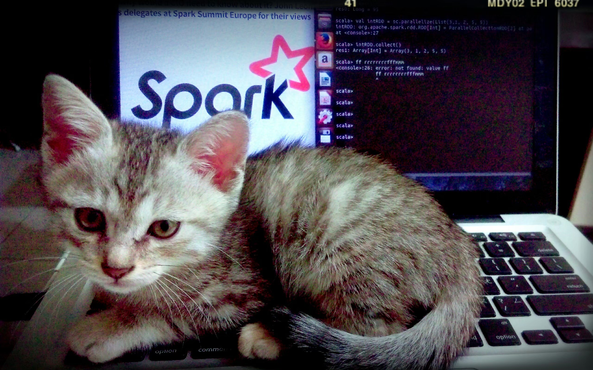

## Resolução

O exercício fornece uma imagem chamada `cat.jpg`.



Ao analisar os metadados da imagem utilizando o site [Aperi'Solve](https://aperisolve.fr/), encontramos um texto suspeito na aba **License**:

```text
YWNhZGVteXt0aGVfbTN0YWRhdGFfMXNfbW9kaWZpZWR9
```

Em seguida, utilizamos o site [dCode](https://www.dcode.fr/) para identificar o método de codificação utilizado. Após a análise, identificamos que o texto estava codificado em **Base64**.

Ao decodificar o conteúdo, obtemos a seguinte flag:

```text
academy{the_m3tadata_1s_modified}
```

**Flag encontrada:** `academy{the_m3tadata_1s_modified}`
